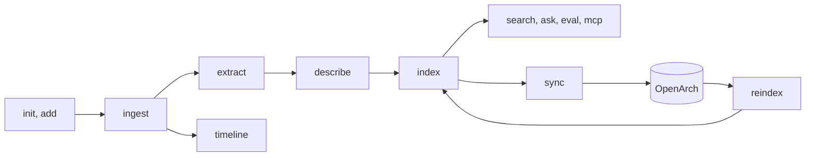

# Design

`openarch-docs` helps one person work with the documents of one case. A case is one folder of documents about one matter, such as a claim, a dispute or a request, where the facts are spread over emails, chat exports, PDFs, scans and photos. The tool records every file with its checksum, extracts the text, and answers questions with a source for every fact. All models run locally.

It is one Go binary. It runs as the `openarch docs` plugin of the CLI for OpenArch (github.com/AlfrescoLabs/openarch-cli), or on its own. Hyland OpenArch is the document store that the CLI for OpenArch installs and runs; openarch-docs keeps each case there.

The goal is the simplest deployment (fewest tools, least CPU, memory and model calls) with acceptable answers. "Acceptable" is checked, not targeted: `eval` on the synthetic sample case in `examples/agent` is the regression check.

This document describes the current build. Flags and file formats are in `openarch docs <command> --help`.

## Rules

1. **Local models only.** Chat, vision and embeddings run on Docker Model Runner, because case documents are private.
2. **No outside network.** The plugin never fetches documents or web pages. Law texts and screenshots are files the user adds with `add` (`--source-url` records where they came from), so every source is a file in the case. The plugin talks only to Docker Model Runner on localhost and to the configured OpenArch. Setup needs the network once: Docker pulls the models and the base image of the tools image.
3. **OpenArch is required.** It is the store of record for originals and derived files, because a case folder on one laptop is easy to lose. Only `sync` and `reindex` call it; every other command works from the case folder. The local index is a cache that can be rebuilt.
4. **Originals never change.** Every original has a SHA-256 checksum. Every derived file records its source file and, when it applies, the attachment name and the message headers. An answer must be traceable to the files as they were received.
5. **Only Docker on the host.** Text extraction, page rendering and OCR run in the plugin tools image with no network, so they behave the same on every OS. `--tools local` runs the same programs from `PATH` with no sandbox; it is for development and tests.
6. **Same output contract as openarch.** Every command supports `--output json`. Results go to stdout, logs to stderr. In JSON mode errors also go to stdout. Exit codes and the JSON error shape are the ones of openarch (`openarch-docs --help` lists the codes), so scripts and agents handle both tools the same way.
7. **Languages.** English, Spanish, French and Portuguese. The words that mail clients and chat exports write (forward markers, quoted headers, attachment lines), month names, common words and the OCR codes live in one table, `internal/lang`. Parsers match every language at once, so one case folder can mix them. A new language is one new entry plus its tesseract language pack in the tools image.
8. **Answers cite sources.** The model is asked to cite a source for every fact. A citation names a file, and a page when there is one. Case facts, reference texts (laws) and notes (interpretations) are labeled by role. `ask` checks the citations after the answer; the checks flag doubtful citations, they do not prove an answer right.

## Decisions

| Decision | Rejected option | Trade-off |
| --- | --- | --- |
| A plugin of openarch | Built into openarch | openarch stays small; costs a second binary. |
| SQLite FTS5 and a scan of all vectors, in one file | A vector database | No extra service; too slow for tens of thousands of chunks. |
| A tools image with poppler and tesseract | Go libraries for PDF and OCR | Mature OCR in four languages on every OS; costs an image build on first use. |
| `ask` makes no tool calls; agents use the MCP server | An agent loop inside `ask` | Works with small models; `ask` cannot look for more sources itself. |
| Provenance in the description of each OpenArch document, through the `openarch` CLI | A manifest document, or the REST API | Each document carries its provenance and the plugin never sees a password; costs one process per file. |

## Pipeline

`ingest` records the originals and unpacks emails and chats. `extract` gets the text of PDFs and images. `describe` writes a text for photos, plans and image pages. `index` builds the search index. `sync` uploads whatever exists, so it can run after any step. `status` names the next step. `verify` checks every original and derived file against its SHA-256 and reads every zip original; it needs no model and no OpenArch.

## Plugin contract

openarch runs `openarch-docs` with the arguments after `docs`. Global flags given to openarch before `docs` arrive as environment variables. This binary reads all of these as flag defaults:

| Variable | Flag or use |
| --- | --- |
| `OPENARCH_OUTPUT` | `--output` (set by openarch) |
| `OPENARCH_NON_INTERACTIVE` | `--non-interactive` (set by openarch) |
| `OPENARCH_VERBOSE` | `--verbose` (set by openarch) |
| `NO_COLOR` | `--no-color` |
| `OPENARCH_DOCS_CASE` | `--case`. With neither, the current folder. |
| `OPENARCH_DOCS_PROFILE` | `--profile` |
| `OPENARCH_DOCS_MODEL_URL` | `--model-url` (default `http://localhost:12434/engines/v1`) |
| `OPENARCH_BIN` | The `openarch` binary to run. Without it, `openarch` from `PATH`. |

`OPENARCH_WORKSPACE` and `OPENARCH_CONTEXT` select the OpenArch workspace and connection. The plugin does not read them itself: it runs `openarch`, which reads them. `--openarch-context` on `sync` and `reindex` picks another context.

## Model profiles

| Profile | Chat and agent | Vision | Embeddings | RAM |
| --- | --- | --- | --- | --- |
| `small` | `ai/qwen2.5` (7B) | `ai/gemma3:4B-Q4_K_M` | `ai/mxbai-embed-large` | 16 GB |
| `large` | `ai/glm-4.7-flash:31B` | `ai/gemma3:4B-Q4_K_M` | `ai/mxbai-embed-large` | 32 GB |

`ask` and `eval` use the chat model. Only the agent of `examples/agent` makes tool calls. On the small profile that agent does not call tools reliably, so the small profile is for `ask`. gemma3 reads scans and photos but cannot make tool calls on Docker Model Runner, so it is used only for vision.

Before `describe` and `look` on the large profile, the CLI unloads the chat model (`docker model unload`), so the vision model has enough memory. The MCP `look` tool does not unload: in an agent run both models stay loaded.

## Case folder and ingest

| Path | Content |
| --- | --- |
| any file outside the folders below | Original case documents (role `case`). Never changed. |
| `references/` | Reference texts the user adds, such as laws. Originals with role `reference`. |
| `pasted/` | Text the user pasted with `add --text`. Originals with role `case`. |
| `notes/` | Notes and drafts (role `note`). Interpretations, not sources. Never originals. |
| `extracted/manifest.json` | Every original (path, SHA-256, size, kind, role) and every derived file (path, SHA-256, source, provenance). |
| `extracted/<name>-<hash8>/` | Derived files of one original. `<hash8>` is the start of its SHA-256, so a changed original gets a new folder. |
| `extracted/index.sqlite`, `extracted/sync.json` | The search index (a cache) and the sync state. |
| `.ask/` | The `ask --continue` conversation. |

Hidden files and agent files (`AGENTS.md`, `CLAUDE.md`) are not originals. Files in `extracted/` that are not in the manifest are left alone.

`ingest` records each original and writes its derived files. Each original records the parser version that wrote them. When the parser version changes in a release, `ingest` writes those derived files again and keeps the `extract` results of files that still exist.

Email text is cleaned: HTML entities in plain text parts are decoded, and text labeled ISO-8859-1 that uses Windows-1252 characters (en dash, euro sign, curly quotes) is read as Windows-1252, as browsers do.

Derived files of an email: `message.txt` (headers and body text), `message.html`, `attachments/`, `inline/`, and `message-N/` for each attached email with its own `message.eml`. Provenance in the manifest:

- `message`: the headers of the email that holds the file.
- `chain`: the emails around it, outermost first, for attached emails.
- `forwarded`: the forwarded or quoted messages found in the body text (marker lines such as "Forwarded message" or "Mensagem encaminhada", or a `From:`/`De :` block), in every supported language.
- `part` and `attachment`: the MIME part number and the file name the sender gave.

Derived files of a WhatsApp export (iOS or Android, in any supported language): `chat.txt`, `messages.json` and `media/`. Each media file records who sent it and when. The export decides the date order (day or month first). When no date in the export shows the order, `messages.json` keeps the time as written and has no ISO time.

## Init, add, status and collect

- `init [folder]` makes the folders, writes `AGENTS.md` (rules for people and agents: layout, citations, facts apart from interpretations, privacy) and installs the skill. It never changes a file that exists.
- `add <file>...` copies files into the case folder, or saves stdin in `pasted/` with `--text`. Then it ingests, and the manifest records how each original was added, from where and when. A file with the same name and other content is an error.
- `status` counts the work left for each step and the `verify` problems, and names the next command. It needs no model and no OpenArch.
- `collect <file>...` copies files to `notes/outbox/<date>/` to attach to a reply. Attachments get the name the sender gave them, and `collect.json` records where each file came from.

## Extract

`extract` reads every PDF and image: originals, and files that `ingest` unpacked (attachments, inline images, chat media, zip files). Results go next to the file: `extracted/<name>-<hash8>/` for an original, `<file>.extract/` for an unpacked file.

| File | Kind | Content |
| --- | --- | --- |
| `page-NNN.txt` | `page-text` | PDF text layer of the page (method `text-layer`). Only when the page has text. |
| `page-NNN.png` | `page-image` | Image of the page, for vision models and for people. |
| `page-NNN.ocr.txt` | `page-ocr` | OCR of the page, when the text layer has fewer than `--min-text` letters and digits (method `ocr`). |
| `ocr.txt` | `image-ocr` | OCR of an image. |

Each entry has `from` (the PDF or image), `page`, and `images`: the number of images that cover a large share of the page (from `pdfimages -list` and `pdfinfo`), so most logos and letterheads do not count. Pages with images are listed in the result, because photos and plans carry facts that the text does not.

Tools: poppler (`pdfinfo`, `pdftotext`, `pdfimages`, `pdftoppm`) and tesseract with `eng`, `spa`, `fra` and `por`. They run in the tools image, built locally from `internal/tools/Dockerfile` on first use (the tag holds a hash of the Dockerfile). Each run has no network, no capabilities, and only the input file (read only) and a work folder mounted.

HEIC and WebP files are reported as unsupported, because tesseract cannot read them.

## Index and search

`index` keeps `extracted/index.sqlite` (pure Go SQLite). Deleting it costs a rebuild, including new embeddings.

- Texts: email bodies, chat messages (one line per message, with time and sender), page texts and OCR, image descriptions, text originals, and every `.md` and `.txt` file in `notes/`.
- Each text is split into chunks with some overlap, at paragraph, line or sentence ends. Chunks with almost no letters and digits (OCR noise of photos) are dropped.
- An email body is first split at each forwarded or quoted message (marker lines, `From:` blocks after a separator line, and reply lines such as "On <date>, <sender> wrote:"). Each part gets the sender and date of its own message, because a thread holds the words of many writers.
- Each chunk keeps its citation (file name, email subject, page, "(OCR)" or "(image description)"), path, role, sender and date. The citation is part of the searchable text, so a file named `attachment-18.pdf` is found by the subject of its email.
- Full text search: FTS5 with accents folded, so queries without accents find accented words. Common short words of each language are left out of queries; question words such as "donde" or "where" stay.
- Embeddings: the embed model of the profile, with the citation before the chunk text. Vectors are compared by dot product over all chunks.
- Only texts whose SHA-256 changed are split again. Chunks without embeddings (after `--no-embed`, or after a change of embedding model) get them on the next run.

`search` merges the full text list and the embedding list with reciprocal rank fusion. When the query names a page ("página 6", "page 6", "p. 6"), two more lists with only the chunks of that page join with more weight. Each hit says which search found it (`text`, `meaning`, `page`).

## Ask

`ask` answers in four steps.

1. **Question.** Without flags each question stands alone. With `--continue` it is part of a conversation kept in `.ask/history.json`: the model first rewrites the question so that it stands alone, from the last turns, and search uses that question. `--new` starts a new conversation.
2. **Retrieve.** Search for case and reference chunks, plus a few notes marked as interpretations (`--no-notes` leaves them out). When the question asks for the newest documents (words such as "último", "latest", "dernier"), the first chunks of the newest messages join, outer emails and quoted messages alike. Messages with almost no text of their own are skipped: a forward that only wraps a quoted thread holds no new fact. Their dates come from the same date reader as `timeline`.
3. **Sources.** Pieces of the same message become one source. Each quoted message of a thread is its own source. Each source is between `<source n="N" role="..." file="..." path="..." sender="..." date="...">` and `</source>`. The question comes before and after the sources.
4. **Model.** The chat model answers at temperature 0 with a fixed seed, so runs on the same machine and model can be compared. The model makes no tool calls.

The system message asks the model to answer in the language of the question; to cite a source for every fact, the source where it read the words, since emails quote other emails; to say plainly when the sources do not hold the answer; to keep facts apart from interpretations, with notes as interpretations and references as rules; to blame nobody without a source; and, for facts from emails and chats, to say who wrote them and when (a greeting names the reader, not the writer). Thinking is off by default, because a thinking model can use all its tokens and write no answer; `--think` turns it on.

The answer is 1 to 5 sentences with source numbers; an answer with only citations gets one retry, then a `warning`. The result lists the sources, marks the cited ones, and lists cited numbers that are not sources (`unknown`): a sign of a made-up citation.

Models often cite the source of the writer instead of the source of the words. So a citation check, with no model, counts for each sentence the content words found in each source. When a source that is not cited holds clearly more of them (at least 1.5 times as many as the best cited source), the sentence is listed in `checks` with the better source.

## Timeline

`timeline` needs no model. It lists, oldest first, each email, each forwarded or quoted message in an email body, and each chat message (time, sender, text or attachment name).

Quoted dates are read in every supported language ("mié, 29 oct 2026 a las 18:00", "Fri, Oct 30, 2026 at 5:51 PM", "29 de outubro de 2026 18:00", "30/10/2026 7:51"). Numeric dates are day first, unless the second number is over 12. Times stay in the time zone of the source. A message that is an email in one file and a quoted forward in another is listed once, as the email.

## Describe and look

`describe` writes a text description, with the vision model of the profile, for each PDF page image with large images (or every page with `--all-pages`), and for each image original, attachment, inline image, chat photo and zip image. Small images (logos in signatures) are skipped. Pages that are mostly text, such as a scanned deed, are left to their text layer or OCR, because their text holds what matters.

The prompt asks for fixed headings, every readable text exactly as written, no guesses, and the main language of the case (or `--lang`). The description goes next to the image (`describe.txt` or `page-NNN.describe.txt`), and its manifest entry records the image, the page and the model.

`look` sends one or more images and one question to the vision model. An image is a path in the case folder or `<pdf>#<page>`. The answer language follows the question. Nothing is saved.

## Sync and reindex

`sync` uploads every original to `<remote>/originals/<path>` and every derived file to `<remote>/<path>` (paths start with `extracted/`). The default remote is `/cases/<slug of the case folder name>`. The search index is not uploaded. `sync` never deletes a remote document.

The description of each uploaded document is the text `openarch-docs/1`, a space, and one line of JSON: `{"role":"original","original":{...}}` or `{"role":"derived","derived":{...}}`, the manifest entry of the file. (This `role` says original or derived; it is not the manifest role.) `extracted/sync.json` keeps the remote, the folder ids, and the id and SHA-256 of each uploaded file. Only files whose SHA-256 changed are uploaded again, with `openarch documents upload --replace`, so a document keeps its id.

`reindex` reads the descriptions of the remote tree, downloads each file whose local copy is missing or differs, and merges the entries into the local manifest. A local original that differs is never overwritten; it is a conflict. A download that does not match the SHA-256 in its description is not written and gets no manifest entry; it is listed as corrupt. Documents without the description prefix, and paths that would leave the case folder, are skipped. Then it updates the search index.

The plugin runs `openarch ... --output json --non-interactive` for every call, so it never sees a password. Exit codes of openarch pass through (6 for a failed login). It needs an openarch whose `documents upload` has `--replace` and `--description`.

## MCP server, notes and skill

`mcp` runs an MCP server on stdio with the MCP Go SDK. `mcp --help` lists its tools. Every tool reads, except `note_write` and `collect`, which write only in `notes/`; `--read-only` leaves them out, and `--no-vision` leaves out `look`.

- `read` returns text files only, in parts, with the manifest entry of the file as `provenance`. The manifest and `sync.json` are refused; `files` lists the manifest instead.
- Paths that would leave the case folder are refused. Results have a fixed size limit, so one result does not fill the context of a small model. Lists drop items from the end and set `cut`; `read` gives less text and a `next_offset`. A result stays valid JSON.

`note write` and `note_write` write only in `notes/`, with at most one folder (`drafts/reply.md`). An existing note needs `--overwrite`. Notes are indexed with the role `note` on the next `index`.

The Agent Skill `skills/openarch-docs/SKILL.md` is embedded in the binary. `skill install` writes it under `.claude/skills/` in the case folder, a hidden folder, so the skill is not part of the case.

`examples/agent` runs Docker Agent with the MCP server as its only toolset, on a synthetic sample case, and checks the folder after the run.

## Eval

`eval <questions-file>` runs `ask` on each question of a file and scores the answers in two ways: expected and forbidden words (no model), and a judge model that checks the key facts of a right answer. The judge is the chat model of the profile by default, so the small profile never loads the large model; `--judge-model` picks another, and comparing two profiles needs the same judge for both. The question file format is in `eval --help`.

`examples/agent/eval.sh` runs `eval` on the synthetic sample case, as a regression check of answer quality. `examples/demo` is a second synthetic case, in English, with its own questions. Question files of private cases stay out of the repository.

## Limits

- **Untrusted text.** Case documents come from other people and go to the `ask` prompt and the MCP agent, so a document can hold instructions. Limits on the damage: no network, no tool calls in `ask`, MCP writes only in `notes/`, `--read-only`. Source text is escaped, so a document cannot end its source tag or start a new one.
- **Stale remote files.** `sync` never deletes in OpenArch, so `reindex` brings back the files of a changed or deleted original. Accepted, because originals should not change.
- **Memory.** The RAM figure of each profile is the machine size it was tried on. In an agent run with `look`, the chat and vision models are loaded together.
- **Context.** The plugin does not set or check the context size of the model. A long `ask` prompt can pass it, and the answer gets worse with no error.
- **Scale.** Tried on cases of about 100 files and 500 chunks. Every search reads all vectors; a case with tens of thousands of chunks would need a vector index.
- **Setup.** The network is needed once, to pull the models and build the tools image.
- **Answers.** The models can be wrong. The citation checks are hints. Check important facts in the cited files.
- **Privacy.** Case data is in the case folder, OpenArch, `.ask/` and the notes.
